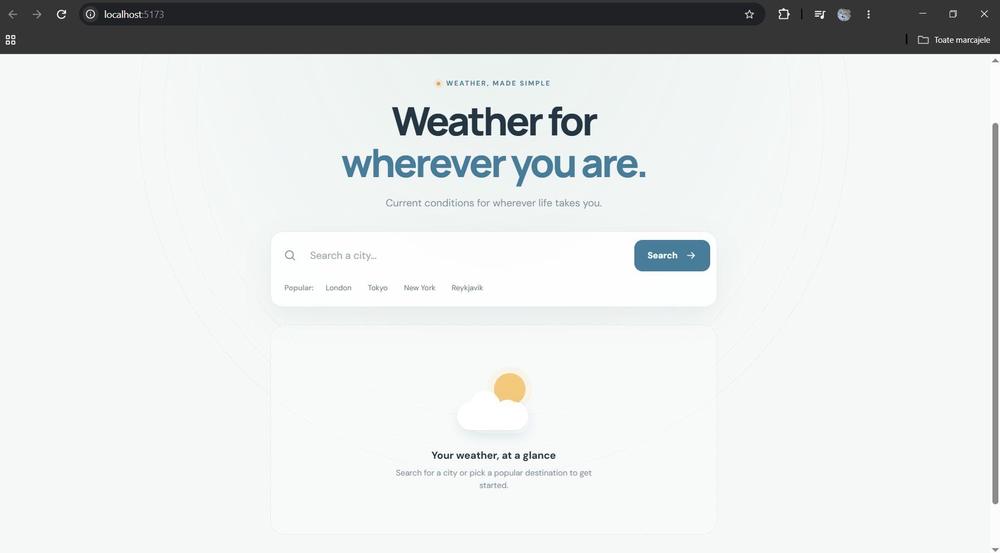
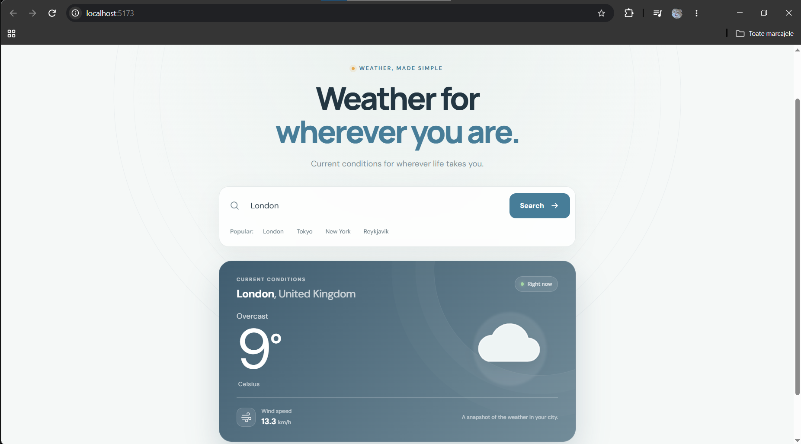

# Weatherly

Weatherly is a city weather app that displays current temperature, wind speed, and weather conditions in a responsive interface. Search for a city or choose a popular destination. Weather and geocoding data are provided by [Open-Meteo](https://open-meteo.com/). I created this app to apply my knowledge of API's and http requests and also learn AI assisted programming by using GitHub Copilot for creating the frontend.



The initial view invites users to search for a city or choose one of the popular destinations.



The results view shows the selected city, current temperature, weather condition, and wind speed.

## Requirements

- Python 3
- Node.js and npm

## Run locally

Start the Flask API in one terminal:

```bash
cd backend
python -m pip install flask flask-cors requests
python backend.py
```

Start the Vite frontend in another terminal:

```bash
cd frontend/frontend
npm install
npm run dev
```

Open the local URL printed by Vite. The frontend expects the API at `http://localhost:5000/api/weather`. The frontend runs at `http://localhost:5173/`.

## Frontend commands

Run these from `frontend/frontend`:

```bash
npm run lint
npm run build
npm run preview
```
